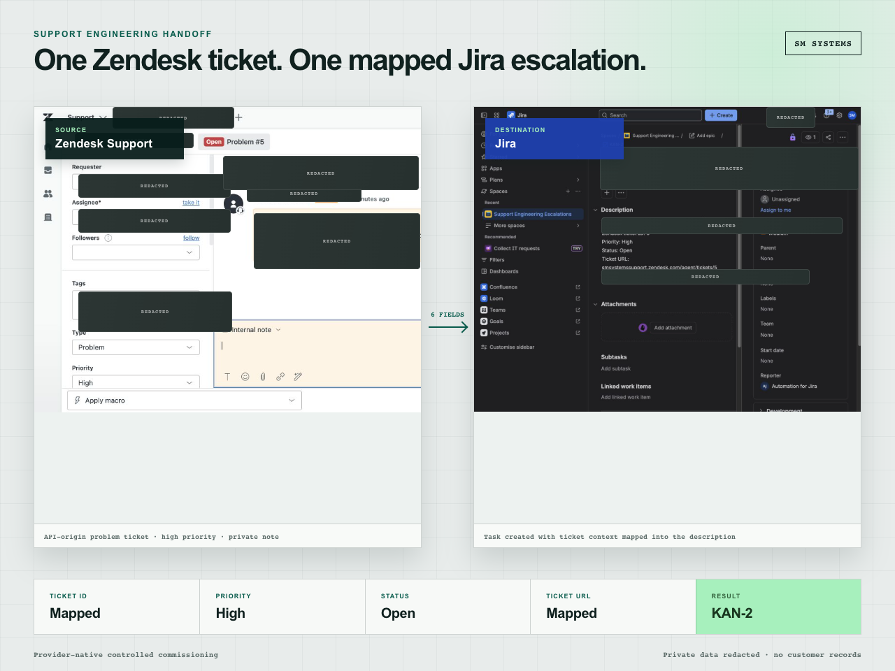
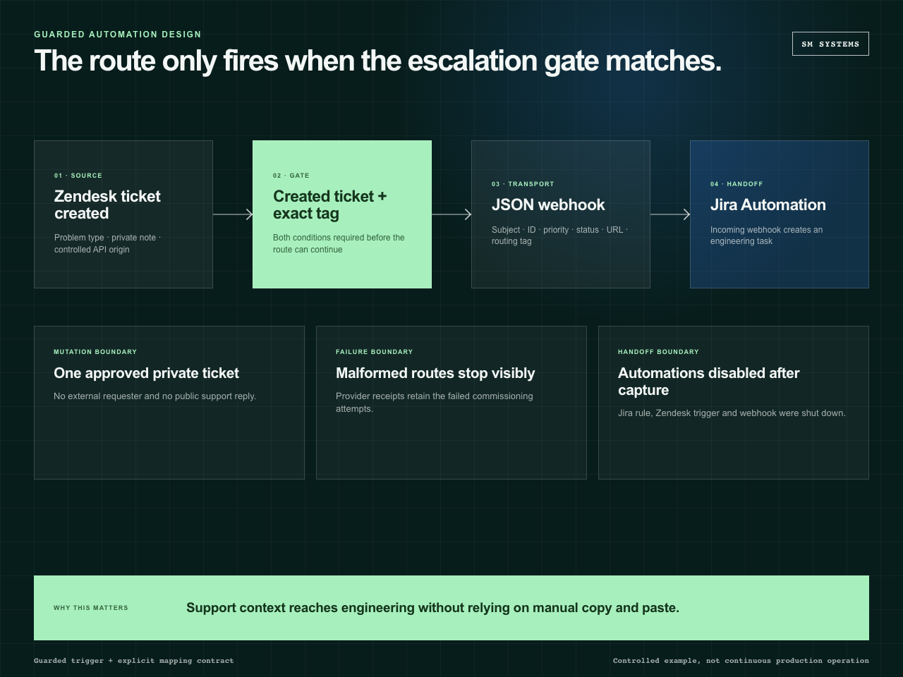
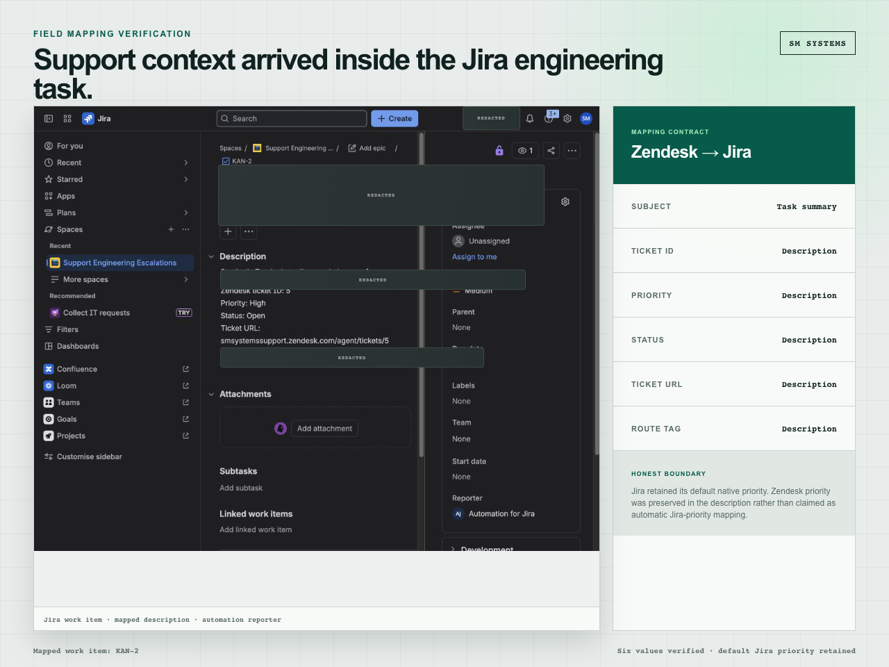
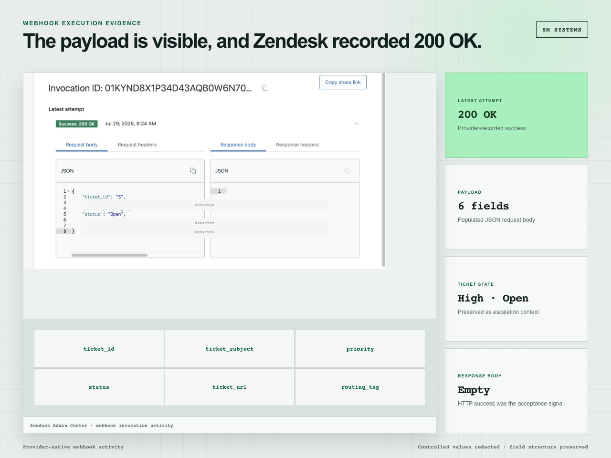

# Zendesk to Jira Support Escalation

A guarded support-to-engineering route that turns an approved Zendesk problem ticket into one mapped Jira task.

| | |
| --- | --- |
| Status | Implemented and provider-validated |
| Role | Trigger design, webhook integration, field mapping and failure reconciliation |
| Stack | Zendesk, Jira Automation, JSON webhooks |

## Escalation path

```text
private Zendesk ticket
        │
        ├── type = problem
        ├── approved escalation tag
        └── created event
                  │
                  ▼
          Zendesk trigger
                  │
                  ▼
      authenticated webhook
                  │
                  ▼
          Jira Automation
                  │
                  ▼
      Support Engineering task
```

The route is intentionally narrow. It accepts synthetic or internally approved tickets, uses a private Zendesk comment, and maps six fields into Jira. It does not send a customer reply.



## Trigger and payload

The Zendesk trigger requires all configured conditions, including the exact escalation tag. The webhook sends only:

- ticket ID;
- subject;
- priority;
- status;
- ticket URL;
- escalation tag.

Jira Automation validates the shared endpoint configuration and creates a task in the designated engineering project. The issue description retains the source ticket URL and mapped support context.





## Provider reconciliation

The initial ticket request used Zendesk's `new` state. Zendesk normalised the record to `open`, so the CLI write receipt reported that its exact-field readback did not match.

The route was not retried blindly. A separate read confirmed that the ticket existed once with the expected private comment, tags and normalised status. Zendesk's webhook returned HTTP 200, Jira Automation completed successfully and the destination search found one matching task.



## Activation boundary

The automation was disabled after the controlled route test. Provider URLs, webhook secrets, tenant identifiers and live ticket IDs are excluded from this repository.

The Zendesk AI Support Copilot uses the same integration family with a stricter application-level approval and idempotency layer. This repository isolates the provider-native trigger, mapping and reconciliation decisions.

## Validate the route contract

```bash
npm run validate
```

## Repository contents

```text
assets/       selected route and provider screens
contracts/    trigger and Jira mapping contracts
examples/     controlled request and result
scripts/      structural validator
docs/         failure and activation notes
```

[Provider workflow notes](docs/architecture.md)
